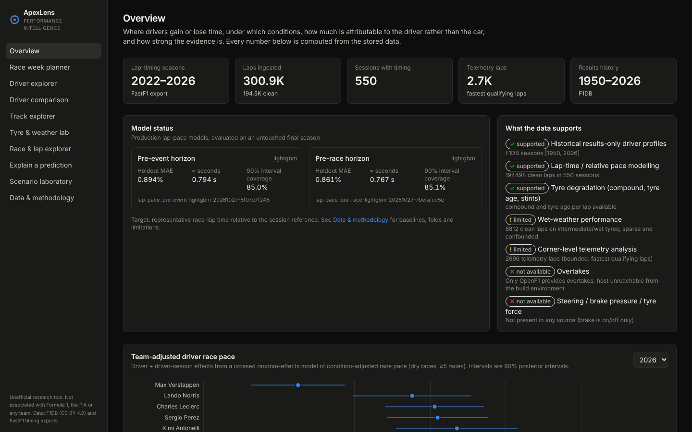
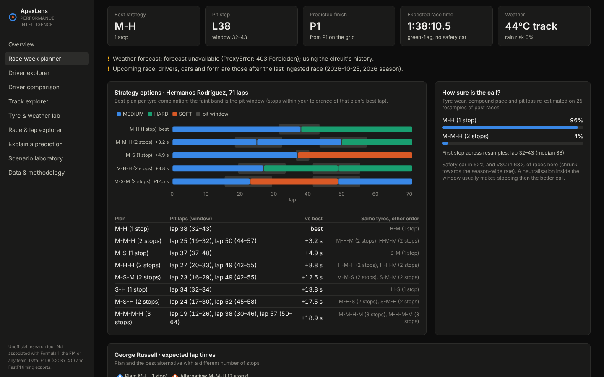
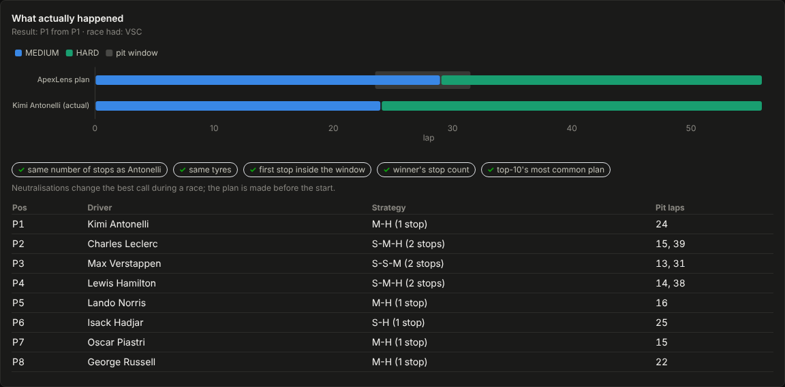
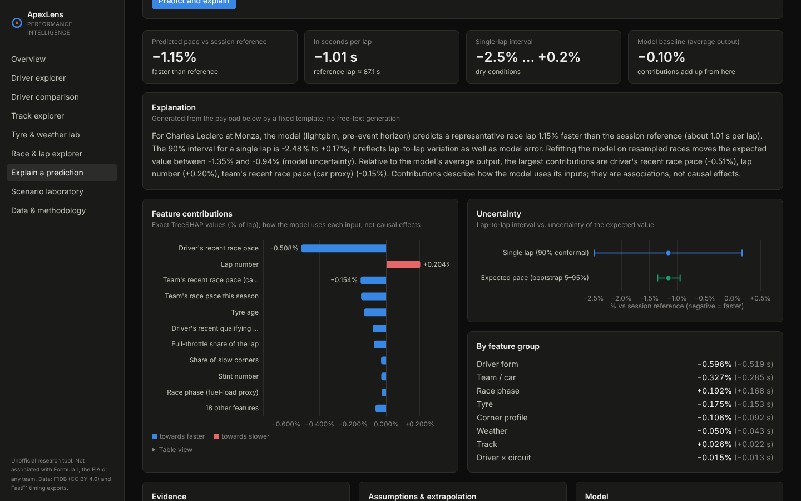
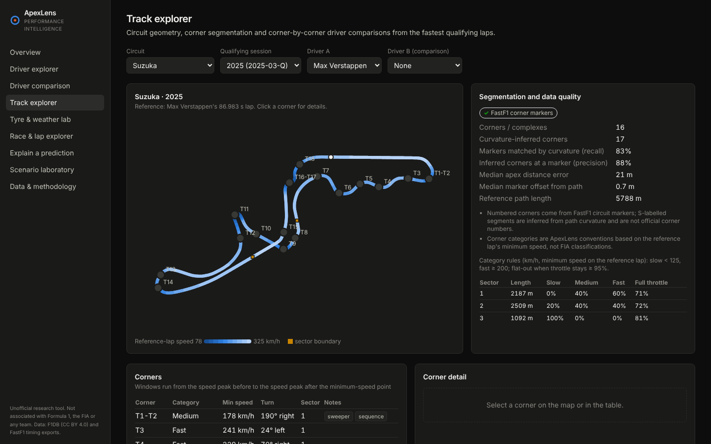

# ApexLens — Explainable Formula 1 Performance Intelligence

ApexLens estimates where Formula 1 drivers gain or lose time, under which conditions, how much of it
belongs to the driver rather than the car, and how strong the evidence is. It ingests real timing data,
builds leakage-safe features, fits team-adjusted driver profiles and lap-pace models with honest
temporal evaluation and uncertainty, and explains every prediction in a dashboard and an API.



**What it is not:** a betting tool, an official F1 product, or a source of causal claims. Explanations
describe how models use their inputs; they are associations learned from observational data.

## Highlights

* **Real, traceable data** — F1DB (results and identities, 1950–present) and a public FastF1 export
  (every lap, tyre, weather, race-control message and qualifying telemetry for 2022–2026). Every record
  is linked to its source in a provenance registry; nothing is synthesised.
* **Driver vs car** — a two-stage model (per-session condition adjustment, then crossed random effects for
  driver, driver-season and team-season, fitted by REML) separates driver pace from car pace, with
  posterior intervals and explicit *insufficient evidence* states.
* **Lap-pace models with honest evaluation** — five models from a historical median to LightGBM,
  walk-forward by season, a holdout season used once, event-cluster bootstrap intervals for every
  comparison, split-conformal prediction intervals, and a bootstrap ensemble for model uncertainty.
* **Explainability as a feature** — exact TreeSHAP, grouped permutation importance, ALE, plain-language
  narratives, counterfactuals, and a validation suite for the explanations themselves.
* **Track geometry** — circuit paths, corner segmentation and classification from telemetry, and
  team-mate corner deltas restricted to comparable laps.
* **Race week planner** — pick a race weekend, a driver and (optionally) another team's car: weather
  (forecast, weekend sessions or circuit history), the best dry tyre strategy with pit windows from an
  exact optimisation, expected lap times, the predicted finishing order — and for past races what really
  happened, plus a backtest of every race since 2023 against what the top-10 actually did.
* **Ten-page dashboard** — overview, race week planner, driver explorer, driver comparison, track
  explorer, tyre & weather lab, race & lap explorer, explain a prediction, scenario laboratory, data &
  methodology.

| Race week planner — Mexico City 2026, before the race | Plan vs what happened — Austin 2026 |
|---|---|
|  |  |

| Explain a prediction | Track explorer |
|---|---|
|  |  |

## Results at a glance

From evaluation run `20261027T075133Z` (2022–2026 data, 2026 up to the US GP on 25 October; the full,
regenerated tables are in [`reports/`](reports/README.md)). Errors are in % of the session reference
lap; 95% event-cluster bootstrap intervals.

| Model A (lap pace), holdout season 2026 | MAE | ≈ seconds | 90% interval coverage |
|---|---|---|---|
| Team-adjusted form baseline | 0.898% | 0.798 s | 87.7% |
| Ridge | 0.877% | 0.776 s | 85.9% |
| LightGBM, pre-event | 0.894% | 0.794 s | 85.0% |
| LightGBM, pre-race (adds the weekend's qualifying) | 0.861% | 0.767 s | 85.1% |

* On the 2023–2025 development folds LightGBM is clearly best (e.g. 0.779% vs 0.855% for the baseline in
  2025). On 2026 — new technical regulations — it is **not** significantly better than the team-form
  baseline or Ridge (pre-event −0.004 pp vs baseline, CI −0.059…+0.055): the complex model's edge did not
  survive the regulation change.
* Knowing the weekend's qualifying helps: −0.033 pp on the 2026 holdout (CI −0.049…−0.016).
* Intervals under-cover their nominal 90% (85% in 2026) — treat them as optimistic.
* Car (team-season) differences explain far more race-pace variance than stable driver differences
  (0.50 vs 0.08 %², after 2026 widened the gaps between cars); once dry pace and car are accounted for,
  no driver's wet-weather, street-circuit or circuit-type deviation is distinguishable from zero.
* Driver corner-type specialisation (slow vs fast corners) is not repeatable between halves of a season;
  driver corner profiles improve sector-time predictions only negligibly (−0.002 pp).
* Form features lag car development: Aston Martin ran 1.8% slower than predicted in the first half of
  2026 and Mercedes 0.7% faster; McLaren 2023 was predicted too slow after its mid-season upgrade.

**Race week planner backtest** (every race since 2023 planned with earlier data only, compared with what
the top-10 finishers did; [report](reports/race_strategy.md)):

| Matches the top-10's most common choice (71 dry races) | Planner | Copy last year's race |
|---|---|---|
| Number of stops | 62% (51–73%) | 58% (47–69%) |
| Stops + set of compounds | 44% (32–55%) | 42% (31–55%) |
| Starting compound | 82% (72–90%) | 90% (82–97%) |
| 2026 only (new rules, 14 races): stops + compounds | 57% | 31% |

* The planner is about as good as copying last year's race overall, and better in 2026 when last year's
  cars no longer tell you much — but on 14 races that difference is not conclusive.
* Finishing order (88 races): rank correlation 0.79 vs 0.75 for the starting grid (+0.033, CI
  +0.016…+0.051); the winner is called in 64% of races vs 66% for "best-placed starter wins".
* Replaying the top-10's actual strategies through the model gives lap times 0.14 s/lap closer to reality
  than a constant-pace guess (CI 0.07–0.22 s).

## Quick start

Requirements: Python ≥ 3.11 (3.13 used), Node ≥ 20, git. [uv](https://github.com/astral-sh/uv) is
optional (`make install` uses it).

```bash
make install                 # .venv with the package + dev extras, frontend dependencies
cp .env.example .env         # optional: data directory, seasons, F1DB checkout path, CORS

make ingest-small            # 3 events of 2024 — end-to-end smoke test (a few minutes)
make pipeline                # full research dataset: ingest → features → train → evaluate → reports

make api                     # FastAPI on http://127.0.0.1:8000  (OpenAPI docs at /docs)
make frontend                # dashboard on http://127.0.0.1:5173 (proxies /api)
```

Without `make`:

```bash
python -m venv .venv && . .venv/bin/activate && pip install -e ".[dev]"
python scripts/ingest_season.py --seasons 2022-2026 --telemetry
python scripts/build_features.py
python scripts/train_models.py
python scripts/evaluate_models.py
python scripts/generate_reports.py
uvicorn apexlens.api.main:app --port 8000
cd frontend && npm install && npm run dev
```

Ingestion is bounded and cached: HTTP responses are cached on disk, re-runs are idempotent, telemetry is
limited to each driver's fastest qualifying lap (`APEXLENS_TELEMETRY_LAPS_PER_DRIVER`), and
`python scripts/update_event.py` refreshes a single event.

### Docker

```bash
make docker-pipeline         # run the full pipeline in a container, writing ./data and ./reports
make docker-up               # API on :8000, dashboard (nginx) on :8080
```

## Commands

| Target | What it does |
|---|---|
| `make ingest` / `ingest-small` | F1DB entities and results, lap timing for every session, qualifying telemetry, coverage report |
| `make features` | Corner tables and track maps, lap features, driver profiles, tyre tables, clusters |
| `make train` | Model A for both horizons; walk-forward evaluation; versioned artifacts and production pointers |
| `make evaluate` | Explanation validation, feature ablations, Models B and F, error analysis |
| `make reports` | `reports/*.md`, `docs/data_dictionary.md`, `docs/feature_definitions.md`, `docs/model_card.md` |
| `make test` / `test-fast` | Python tests (real-data tests skip when `data/` is absent) / without the real-data suite |
| `make check` | Lint, Python tests, frontend typecheck and tests |

## API

FastAPI with OpenAPI docs at `/docs`. Main endpoints:

| Area | Endpoints |
|---|---|
| Catalogue | `GET /api/seasons`, `/events`, `/circuits`, `/drivers`, `/constructors`, `/sessions`, `/data-coverage`, `/sources`, `/features`, `/methodology` |
| Sessions | `GET /api/sessions/{id}/laps`, `/weather`, `/stints`, `/results`, `/race-control`, `/telemetry` |
| Drivers | `GET /api/drivers/{id}/profile`, `/drivers/{id}/performance`, `/drivers/compare`, `/driver-effects`, `/driver-clusters`, `/conditions` |
| Tracks | `GET /api/circuits/{id}/layout`, `/corners`, `/performance`, `/drivers/{id}/corner-profile`, `/corner-analysis` |
| Tyres | `GET /api/tyres/degradation`, `POST /api/predict/tyre-degradation` |
| Predictions | `POST /api/predict/lap-time`, `/predict/driver-comparison`, `/explain`, `/scenarios` |
| Models | `GET /api/models`, `/models/{v}/metrics`, `/models/{v}/explanations`, `/models/{v}/explanation-validation`, `/evaluation`, `/experiments` |
| Race week | `GET /api/strategy/race-weeks`, `POST /api/strategy/plan`, `GET /api/strategy/backtest` |

Errors are structured (`{"error": {"code": ..., "message": ...}}`); invalid or unsupported requests
return 422 with the reason, and predictions flag extrapolation and thin evidence in `warnings`.

## Project layout

```
src/apexlens/      data_sources · ingestion · cleaning · features · track_geometry · driver_profiles
                   modeling · evaluation · explainability · predictions · strategy · services · api · reporting
scripts/           ingest_season · update_event · build_features · train_models · evaluate_models · generate_reports
frontend/          React + TypeScript + Vite + Tailwind + ECharts dashboard
tests/             unit · data_quality · modeling · integration (fixtures are real data excerpts)
docs/              architecture, data sources, methodology, evaluation protocol, limitations, generated docs
reports/           generated analysis reports and figures
data/              cache, raw (bronze), processed (silver), features (gold), models, manifests — not in git
```

## Documentation

* [Architecture](docs/architecture.md) · [Data sources](docs/data_sources.md) · [Methodology](docs/methodology.md)
* [Evaluation protocol](docs/evaluation_protocol.md) · [Limitations](docs/limitations.md)
* Generated: [Data dictionary](docs/data_dictionary.md) · [Feature definitions](docs/feature_definitions.md) · [Model card](docs/model_card.md)
* [Reports](reports/README.md): coverage, EDA, feature engineering, driver profiles, model comparison, error analysis, explainability, race strategy backtest
* [Implementation plan](docs/implementation_plan.md) · [Progress log](docs/progress.md)

## Testing

```bash
make test                              # 130+ tests: parsing, adapters (mocked), storage, entity mapping,
                                       # cleaning, data-quality checks, leakage, mixed model, models,
                                       # track geometry, API, real-data invariants
cd frontend && npm run typecheck && npm test
```

CI (`.github/workflows/ci.yml`) runs lint and the fixture-based tests, the frontend typecheck, tests and
build, and builds both Docker images.

## Limitations

Official F1 live timing, Jolpica and OpenF1 were unreachable from the build environment, so lap-level
data comes from a public FastF1 export; the official-source adapters exist but are only mock-tested.
Telemetry is one qualifying lap per driver and session; brake is on/off; fuel, setup and traffic are not
observed; wet-weather evidence is sparse; most training data comes from 2022–2025 cars, while 2026 brought
new regulations. See
[docs/limitations.md](docs/limitations.md).

## Licence and attribution

Code: MIT ([LICENSE](LICENSE)). Data: [F1DB](https://github.com/f1db/f1db) (CC BY 4.0 — attribution
required); [TracingInsights](https://github.com/TracingInsights) FastF1 exports (repositories declare MIT for 2022–2024 and Apache 2.0 for 2025–2026;
the timing data is unofficial — non-commercial research use).

F1, FORMULA ONE and related marks are trademarks of Formula One Licensing B.V. ApexLens is an independent
research project and is not associated with Formula 1, the FIA or any team.
