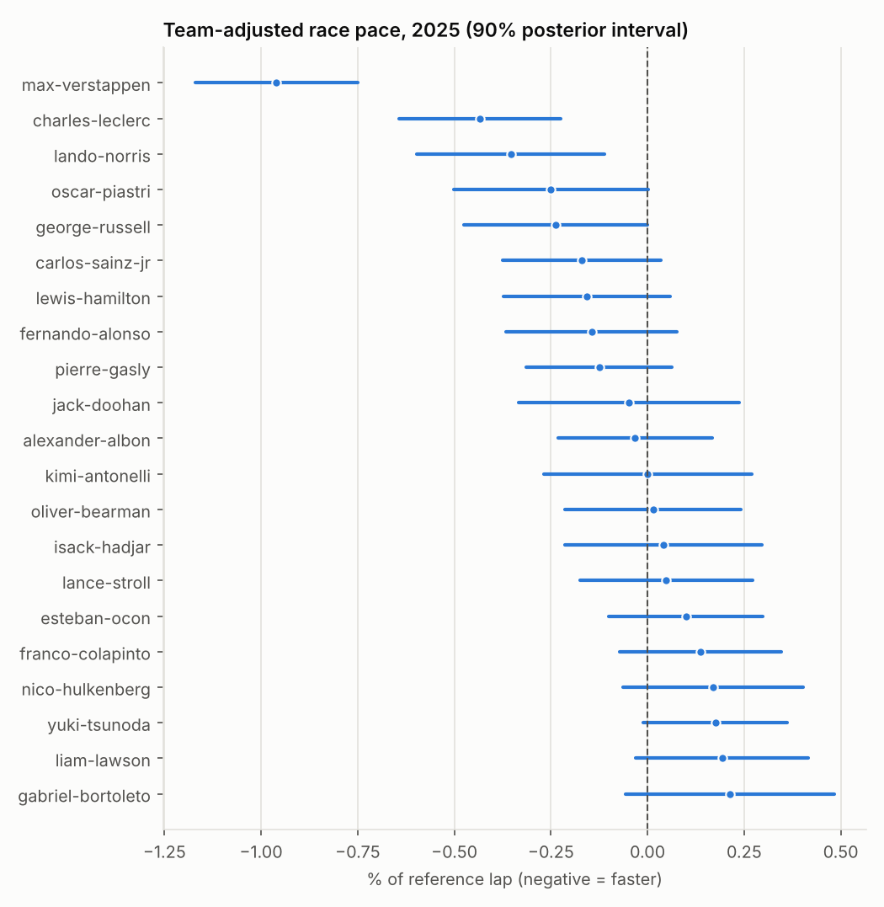

# Driver performance profiles

_Generated 2026-10-26 18:57 UTC by `scripts/generate_reports.py` from `gold/driver_profiles`, `gold/driver_condition_effects`, `gold/driver_clusters`. Do not edit by hand; re-run the script._

## Method

Stage 1 removes, per session, the effects of compound, compound-specific tyre age and lap number from each driver's representative laps (OLS; non-identifiable terms dropped in a fixed order). Stage 2 fits crossed random effects for driver, driver-season and team-season with session fixed effects by REML:

`adj_pace ~ session (fixed) + (1|driver) + (1|driver:season) + (1|team:season)`  
`quali_gap_pct ~ event (fixed) + (1|driver) + (1|driver:season) + (1|team:season); dry, gap <= 5.0%`

## Variance components (%²)

| Component | Race pace | share | Qualifying gap | share |
|---|---|---|---|---|
| driver | 0.104 | 24.6% | 0.212 | 31.3% |
| driver-season | 0.005 | 1.1% | 0.003 | 0.5% |
| team-season | 0.205 | 48.3% | 0.123 | 18.3% |
| residual | 0.110 | 25.9% | 0.337 | 49.9% |

Race model: 1,989 driver-sessions; qualifying model: 1,624 driver-sessions. Team-mate differences are directly identified. The split of a team-season's mean pace into car and driver components relies on drivers who changed teams and on the estimated variance components; cross-team driver comparisons are therefore less certain than the intervals of a single effect suggest.

## Team-adjusted race pace, 2025

19 of 20 adjacent pairs in this ordering have overlapping intervals; the ordering is not a ranking with that precision. Drivers with few races are wide by construction.

| Driver | Team | Dry races + sprints | Adj. pace % | lo | hi | Gap to team-mate % | Quali gap to team-mate % |
|---|---|---|---|---|---|---|---|
| max-verstappen | red-bull | 26 | -0.961 | -1.171 | -0.751 | -1.113 | -1.011 |
| charles-leclerc | ferrari | 26 | -0.433 | -0.643 | -0.224 | -0.226 | -0.218 |
| lando-norris | mclaren | 26 | -0.354 | -0.597 | -0.112 | 0.010 | -0.035 |
| oscar-piastri | mclaren | 24 | -0.250 | -0.502 | 0.002 | -0.010 | 0.035 |
| george-russell | mercedes | 27 | -0.237 | -0.474 | -0.000 | -0.321 | -0.368 |
| carlos-sainz-jr | williams | 25 | -0.170 | -0.375 | 0.034 | 0.071 | -0.097 |
| lewis-hamilton | ferrari | 27 | -0.158 | -0.373 | 0.058 | 0.226 | 0.218 |
| fernando-alonso | aston-martin | 25 | -0.145 | -0.366 | 0.076 | -0.188 | -0.529 |
| pierre-gasly | alpine | 25 | -0.125 | -0.314 | 0.063 | -0.235 | -0.513 |
| jack-doohan | alpine | 5 | -0.047 | -0.333 | 0.238 | 0.403 | 0.632 |

_First ten rows of the ordering; the full table is served by `/api/driver-effects`._

## Condition-specific deviations

Deviation of a driver from their own dry, car-adjusted expectation, shrunk towards zero with empirical Bayes (`tau` = estimated between-driver SD of the deviation). A driver is only *distinguishable* when the 90% posterior interval excludes zero.

| dimension | drivers | tau | insufficient_evidence | not_distinguishable_from_zero |
|---|---|---|---|---|
| high_speed_circuit | 31 | 0.000 | 1 | 30 |
| slow_corner_circuit | 31 | 0.000 | 1 | 30 |
| street_circuit | 31 | 0.000 | 1 | 30 |
| wet_qualifying | 30 | 0.000 | 4 | 26 |
| wet_race | 31 | 0.143 | 6 | 25 |

## Corner-type specialisation

Is a driver's corner delta to their team-mate a repeatable trait? Each driver-season's qualifying sessions (≥ 8) are split into odd and even rounds and the halves are correlated across drivers; the two-sided permutation p-value shuffles drivers between halves.

| Measure | Driver-seasons | Split-half r | Spearman–Brown | Permutation p |
|---|---|---|---|---|
| overall corner delta to team-mate | 64 | 0.236 | 0.381 | 0.069 |
| slow-minus-fast corner specialisation | 64 | -0.058 | -0.124 | 0.635 |

## Clusters (exploratory)

| k | Silhouette | Bootstrap ARI |
|---|---|---|
| 2 | 0.186 | 0.818 |
| 3 | 0.174 | 0.581 |
| 4 | 0.140 | 0.466 |
| 5 | 0.136 | 0.503 |
| 6 | 0.121 | 0.380 |

Chosen k = 2 on 81 driver-seasons with ≥ 10 dry races. Exploratory only. Clusters are stable under resampling. The two groups mainly separate overall pace relative to team-mates (|r| = 0.76 with a combined pace score), i.e. one performance axis rather than distinct driving styles; solutions with three or more groups are unstable.

| cluster | size | description |
|---|---|---|
| 0 | 46 | lower qualifying gap to team-mate (-0.6 SD); lower team-adjusted qualifying (negative = faster) (-0.6 SD); lower race gap to team-mate (-0.5 SD) |
| 1 | 35 | higher qualifying gap to team-mate (+0.8 SD); higher team-adjusted qualifying (negative = faster) (+0.8 SD); higher race gap to team-mate (+0.7 SD) |
