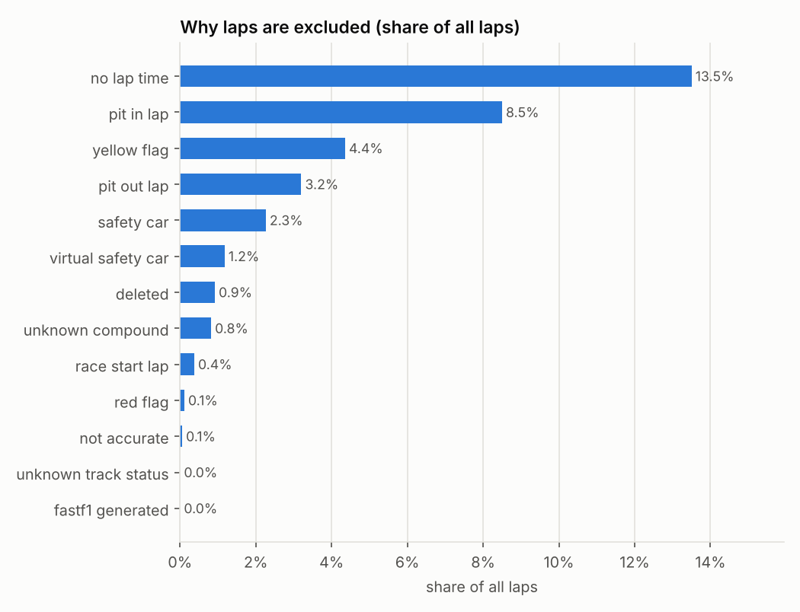
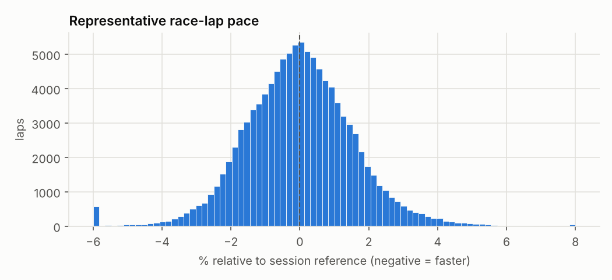

# Exploratory data analysis

_Generated 2026-10-27 08:09 UTC by `scripts/generate_reports.py` from `gold/all_laps_relative`, `gold/lap_features`, `silver/*`. Do not edit by hand; re-run the script._

## Volume by season

| Season | Events | Sessions | Drivers | Laps | Clean share | Race+sprint laps | Representative race laps | Wet/damp share | Telemetry laps |
|---|---|---|---|---|---|---|---|---|---|
| 2022 | 22 | 110 | 34 | 59,565 | 64.0% | 24,882 | 18,765 | 9.5% | 435 |
| 2023 | 22 | 109 | 32 | 58,788 | 65.7% | 26,598 | 21,125 | 7.8% | 555 |
| 2024 | 24 | 120 | 33 | 64,043 | 67.1% | 29,024 | 24,390 | 8.5% | 594 |
| 2025 | 24 | 120 | 36 | 65,655 | 63.7% | 28,844 | 23,204 | 3.8% | 594 |
| 2026 | 18 | 90 | 32 | 52,510 | 62.7% | 23,280 | 18,219 | 1.9% | 518 |

Representative laps (clean and within 5% of the driver's session median) are the modelling population for race pace. Telemetry is the fastest clean qualifying lap per driver and session.

## Lap exclusions

35.3% of 300,561 laps are excluded from pace analysis; each keeps its first matching reason (the order is listed in the methodology).

| Reason | Laps | Share of all laps |
|---|---|---|
| no_lap_time | 40,585 | 13.5% |
| pit_in_lap | 25,551 | 8.5% |
| yellow_flag | 13,097 | 4.4% |
| pit_out_lap | 9,623 | 3.2% |
| safety_car | 6,807 | 2.3% |
| virtual_safety_car | 3,541 | 1.2% |
| deleted | 2,765 | 0.9% |
| unknown_compound | 2,468 | 0.8% |
| race_start_lap | 1,131 | 0.4% |
| red_flag | 343 | 0.1% |
| not_accurate | 170 | 0.1% |
| unknown_track_status | 8 | 0.0% |
| fastf1_generated | 7 | 0.0% |

## Target distribution

Relative pace of 105,703 representative race and sprint laps (quantiles 1/5/25/50/75/95/99%: -4.01, -2.44, -1.02, -0.03, +0.94, +2.53, +4.05). The right tail comes from fuel-heavy opening stints, worn tyres and slower cars; values are clipped to [-6, 8] in the plot only.

## Tyre compounds in representative race laps

| season | HARD | INTERMEDIATE | MEDIUM | SOFT | WET |
|---|---|---|---|---|---|
| 2022 | 34.0% | 3.7% | 41.7% | 20.5% | 0.1% |
| 2023 | 48.0% | 2.0% | 35.0% | 15.1% | 0.0% |
| 2024 | 49.7% | 5.1% | 38.9% | 6.4% | 0.0% |
| 2025 | 41.2% | 4.0% | 43.0% | 11.8% | 0.0% |
| 2026 | 40.8% | 0.9% | 38.8% | 19.5% | 0.0% |

SOFT/MEDIUM/HARD are relative names; the Pirelli C-number differs by event and is not in the data.

## Weather

| Season | Track °C p5 | median | p95 | Air °C p5 | median | p95 | Sessions with rain detected |
|---|---|---|---|---|---|---|---|
| 2022 | 18.6 | 35.0 | 52.5 | 14.7 | 24.3 | 33.2 | 19 |
| 2023 | 18.5 | 36.2 | 48.0 | 15.6 | 25.4 | 31.7 | 30 |
| 2024 | 17.1 | 35.4 | 48.3 | 14.4 | 22.3 | 31.3 | 24 |
| 2025 | 19.3 | 37.1 | 48.9 | 14.4 | 24.8 | 30.9 | 16 |
| 2026 | 23.9 | 40.4 | 54.5 | 15.7 | 25.9 | 33.4 | 12 |

One trackside sensor per circuit, sampled about once a minute.

## Telemetry quality

Checks run per qualifying session over all telemetry samples (`manifests/quality/telemetry_*.json`). Sessions with warnings are kept; corner metrics carry their own per-corner quality flags.

| Season | Check | Severity | Sessions failing | Samples failing | Share of samples |
|---|---|---|---|---|---|
| 2022 | sample_gap | warning | 18 | 85 | 0.03% |
| 2023 | sample_gap | warning | 16 | 88 | 0.02% |
| 2023 | coordinate_discontinuity | warning | 2 | 2 | 0.00% |
| 2024 | sample_gap | warning | 23 | 96 | 0.03% |
| 2025 | sample_gap | warning | 23 | 174 | 0.05% |
| 2026 | sample_gap | warning | 21 | 158 | 0.05% |

## Race control messages

| season | CarEvent | Drs | Flag | Other | SafetyCar |
|---|---|---|---|---|---|
| 2022 | 580 | 142 | 2,115 | 1,721 | 96 |
| 2023 | 214 | 139 | 2,180 | 2,155 | 93 |
| 2024 | 25 | 135 | 2,443 | 2,222 | 60 |
| 2025 | 0 | 134 | 3,300 | 2,504 | 92 |
| 2026 | 0 | 0 | 4,768 | 3,349 | 113 |
