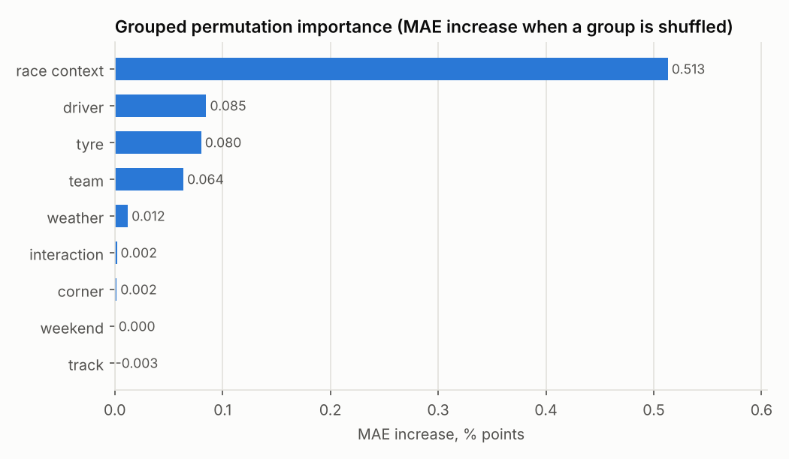
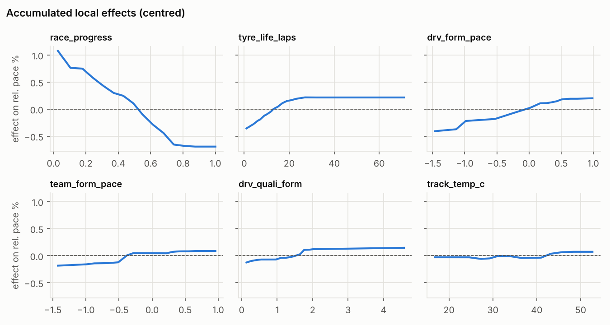
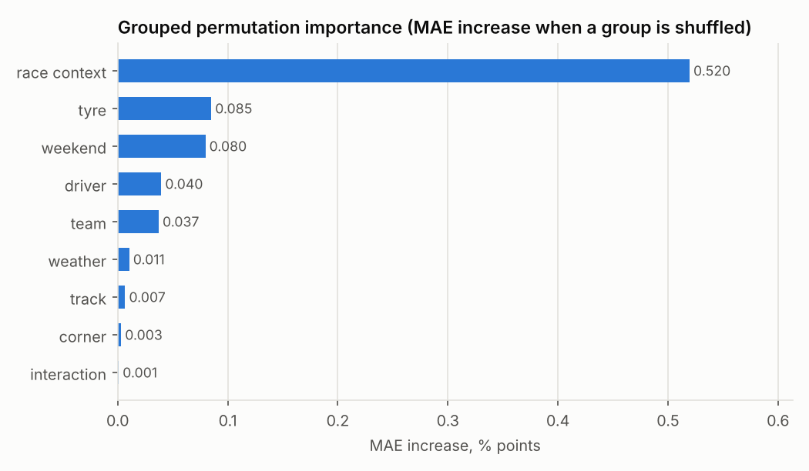

# Explainability

_Generated 2026-10-26 18:57 UTC by `scripts/generate_reports.py` from `evaluation_runs/20261026T182248Z.json`, `models/*/explanation_validation.json`. Do not edit by hand; re-run the script._

All explanations describe how the fitted models use their inputs. They are associations learned from observational data and never causal effects.

## `pre_event`: global explanations (test season 2025 (model trained on 2022-2024), 15,000 laps)

| Feature | Group | Mean \|SHAP\| % | Mean SHAP % |
|---|---|---|---|
| race_progress | race_context | 0.468 | -0.020 |
| lap_number | race_context | 0.274 | 0.016 |
| drv_form_pace | driver | 0.201 | 0.027 |
| tyre_life_laps | tyre | 0.160 | -0.006 |
| team_season_form | team | 0.124 | 0.032 |
| team_form_pace | team | 0.108 | 0.004 |
| drv_quali_form | driver | 0.069 | -0.045 |
| team_quali_form | team | 0.041 | -0.033 |
| humidity_pct | weather | 0.038 | -0.000 |
| circuit_is_street | track | 0.033 | 0.009 |
| stint | tyre | 0.031 | 0.008 |
| is_sprint | race_context | 0.027 | -0.000 |

LightGBM vs Ridge importance ranking: Spearman 0.50 over 17 shared features.

*ALE curves show the model's average response to one input, accounting for correlated inputs; they are not causal effects.*

### Explanation validation (`lap_pace_pre_event-lightgbm-20261026-aac7e5be95`, season 2025, 3,000 laps)

| Check | Result |
|---|---|
| Additivity (base + contributions − prediction), max abs | 1.0e-14 |
| TreeSHAP vs `shap` library, max abs difference | 0.0e+00 |
| Global ranking stability across 20 bootstrap refits (mean / min Spearman) | 0.87 / 0.76 |
| Top-5 feature sets across refits (mean Jaccard) | 0.76 |
| Local top-3 contribution sign agreement across refits | 0.998 |
| Mean SD of local top-3 contributions across refits (%) | 0.077 |
| Agreement with the other horizon's model (Spearman of importance) | 0.93 |
| Agreement with Ridge (Spearman of mean \|contribution\| / sign agreement) | 0.50 / 0.76 |

Top-5 frequency across refits: `race_progress` 100%, `drv_form_pace` 100%, `lap_number` 100%, `tyre_life_laps` 100%, `team_form_pace` 40%.

Sensitivity (mean |Δprediction| % for ±5% SD perturbations): `race_progress` 0.026, `lap_number` 0.015, `circuit_ref_lap_s` 0.014, `drv_form_pace` 0.013, `drv_quali_form` 0.010.

Correlated pairs whose credit SHAP may split arbitrarily: `team_form_pace`/`team_season_form` (0.98), `race_progress`/`lap_number` (0.89), `team_season_form`/`team_quali_form` (0.88), `team_form_pace`/`team_quali_form` (0.88), `drv_form_pace`/`team_season_form` (0.85), `circuit_length_km`/`circuit_ref_lap_s` (0.84).

## `pre_race`: global explanations (test season 2025 (model trained on 2022-2024), 15,000 laps)

| Feature | Group | Mean \|SHAP\| % | Mean SHAP % |
|---|---|---|---|
| race_progress | race_context | 0.466 | -0.014 |
| lap_number | race_context | 0.266 | 0.014 |
| tyre_life_laps | tyre | 0.163 | -0.005 |
| evt_quali_gap | weekend | 0.162 | -0.053 |
| drv_form_pace | driver | 0.144 | 0.021 |
| team_season_form | team | 0.099 | 0.026 |
| team_form_pace | team | 0.071 | 0.006 |
| evt_team_quali_gap | weekend | 0.047 | -0.019 |
| circuit_is_street | track | 0.038 | 0.009 |
| circuit_ref_lap_s | track | 0.032 | 0.021 |
| drv_quali_form | driver | 0.030 | -0.021 |
| team_quali_form | team | 0.030 | -0.025 |

LightGBM vs Ridge importance ranking: Spearman 0.53 over 19 shared features.

### Explanation validation (`lap_pace_pre_race-lightgbm-20261026-cfc083ad08`, season 2025, 3,000 laps)

| Check | Result |
|---|---|
| Additivity (base + contributions − prediction), max abs | 9.8e-15 |
| TreeSHAP vs `shap` library, max abs difference | 0.0e+00 |
| Global ranking stability across 20 bootstrap refits (mean / min Spearman) | 0.88 / 0.75 |
| Top-5 feature sets across refits (mean Jaccard) | 1.00 |
| Local top-3 contribution sign agreement across refits | 0.998 |
| Mean SD of local top-3 contributions across refits (%) | 0.074 |
| Agreement with the other horizon's model (Spearman of importance) | 0.93 |
| Agreement with Ridge (Spearman of mean \|contribution\| / sign agreement) | 0.53 / 0.63 |

Top-5 frequency across refits: `race_progress` 100%, `lap_number` 100%, `drv_form_pace` 100%, `evt_quali_gap` 100%, `tyre_life_laps` 100%.

Sensitivity (mean |Δprediction| % for ±5% SD perturbations): `evt_quali_gap` 0.037, `race_progress` 0.026, `circuit_ref_lap_s` 0.021, `lap_number` 0.017, `circuit_length_km` 0.008.

Correlated pairs whose credit SHAP may split arbitrarily: `team_form_pace`/`team_season_form` (0.98), `race_progress`/`lap_number` (0.89), `team_season_form`/`team_quali_form` (0.88), `team_form_pace`/`team_quali_form` (0.88), `evt_quali_gap`/`evt_team_quali_gap` (0.86), `drv_form_pace`/`team_season_form` (0.85).

## Worked local explanation

Scenario: `kimi-antonelli` before event `2025-24` (Yas Marina), medium tyres 12 laps old, half race distance, `pre_event` model `lap_pace_pre_event-lightgbm-20261026-aac7e5be95`.

Prediction -0.399% of the reference lap (90% interval -1.72 … +0.93; model spread 0.080% SD across bootstrap refits).

| Input | Value | Contribution % |
|---|---|---|
| Driver's recent race pace | -0.344238 | -0.249 |
| Lap number | 29 | 0.119 |
| Team's recent race pace (car proxy) | -0.404833 | -0.115 |
| Tyre age | 12 | -0.076 |
| Race phase (fuel-load proxy) | 0.5 | 0.026 |
| Share of slow corners | 0.428571 | -0.025 |
| Team's race pace this season | -0.3234 | 0.025 |
| Track temperature | 31.9 | 0.023 |

> For Kimi Antonelli at Yas Marina, the model (lightgbm, pre-event horizon) predicts a representative race lap 0.40% faster than the session reference (about 0.36 s per lap). The 90% interval for a single lap is -1.72% to +0.93%; it reflects lap-to-lap variation as well as model error. Refitting the model on resampled races moves the expected value between -0.43% and -0.18% (model uncertainty). Relative to the model's average output, the largest contributions are driver's recent race pace (-0.25%), lap number (+0.12%), team's recent race pace (car proxy) (-0.11%). Contributions describe how the model uses its inputs; they are associations, not causal effects.

Warnings: none.

