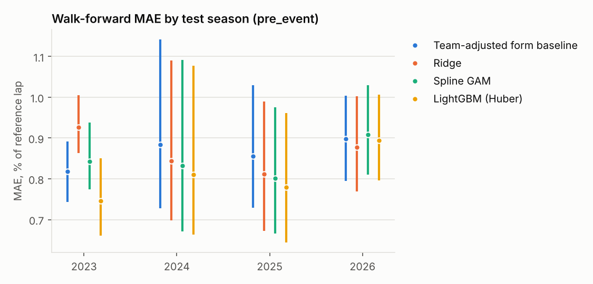
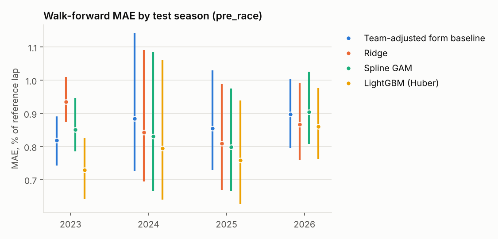

# Model comparison

_Generated 2026-10-27 08:09 UTC by `scripts/generate_reports.py` from `evaluation_runs/20261027T075133Z.json`, `evaluation_runs/*.json`. Do not edit by hand; re-run the script._

Run `20261027T075133Z`; dataset version `{"sessions_manifest_sha": "565045d5ae37a4f5", "lap_features_sha": "5c799359d1af068f", "f1db_seasons": 77}`; seed 42.

Protocol: walk-forward by season (train on all earlier seasons, calibrate conformal intervals on the most recent training events, test on the next season). The last season is a holdout reported once; model selection uses development folds only. Intervals are 95% event-cluster bootstrap; `*` marks an interval that excludes zero.

## Model A — lap pace, `pre_event`

| Test season | Model | Laps | MAE % | 95% CI | RMSE | R² | 90% PI coverage | PI width | MAE s |
|---|---|---|---|---|---|---|---|---|---|
| 2023 | Historical group median | 21,125 | 0.928 | [0.867, 0.988] | 1.250 | 0.235 | 85.6% | 3.327 | 0.820 |
| 2023 | Team-adjusted form baseline | 21,125 | 0.819 | [0.743, 0.892] | 1.162 | 0.339 | 87.8% | 3.203 | 0.722 |
| 2023 | Ridge | 21,125 | 0.927 | [0.863, 1.006] | 1.243 | 0.243 | 86.3% | 3.371 | 0.822 |
| 2023 | Spline GAM | 21,125 | 0.843 | [0.774, 0.938] | 1.155 | 0.347 | 86.7% | 3.158 | 0.745 |
| 2023 | LightGBM (Huber) | 21,125 | 0.746 | [0.661, 0.851] | 1.078 | 0.431 | 86.6% | 2.803 | 0.653 |
| 2024 | Historical group median | 24,390 | 0.947 | [0.810, 1.194] | 1.461 | 0.318 | 87.4% | 3.432 | 0.831 |
| 2024 | Team-adjusted form baseline | 24,390 | 0.884 | [0.727, 1.141] | 1.415 | 0.359 | 89.8% | 3.545 | 0.775 |
| 2024 | Ridge | 24,390 | 0.844 | [0.699, 1.090] | 1.349 | 0.418 | 87.1% | 3.082 | 0.739 |
| 2024 | Spline GAM | 24,390 | 0.832 | [0.671, 1.092] | 1.350 | 0.417 | 87.0% | 3.014 | 0.728 |
| 2024 | LightGBM (Huber) | 24,390 | 0.811 | [0.663, 1.077] | 1.347 | 0.420 | 86.5% | 2.857 | 0.710 |
| 2025 | Historical group median | 23,204 | 0.938 | [0.812, 1.127] | 1.388 | 0.287 | 85.6% | 3.297 | 0.826 |
| 2025 | Team-adjusted form baseline | 23,204 | 0.855 | [0.729, 1.030] | 1.306 | 0.368 | 87.3% | 3.178 | 0.752 |
| 2025 | Ridge | 23,204 | 0.811 | [0.673, 0.990] | 1.263 | 0.409 | 87.0% | 3.006 | 0.714 |
| 2025 | Spline GAM | 23,204 | 0.801 | [0.666, 0.976] | 1.253 | 0.419 | 87.4% | 2.997 | 0.706 |
| 2025 | LightGBM (Huber) | 23,204 | 0.779 | [0.644, 0.962] | 1.237 | 0.434 | 87.0% | 2.833 | 0.685 |
| 2026 | Historical group median | 18,219 | 1.185 | [1.099, 1.271] | 1.620 | 0.215 | 79.2% | 3.686 | 1.056 |
| 2026 | Team-adjusted form baseline | 18,219 | 0.898 | [0.795, 1.003] | 1.250 | 0.533 | 87.7% | 3.514 | 0.798 |
| 2026 | Ridge | 18,219 | 0.877 | [0.769, 1.002] | 1.256 | 0.528 | 85.9% | 3.199 | 0.776 |
| 2026 | Spline GAM | 18,219 | 0.908 | [0.810, 1.030] | 1.322 | 0.478 | 84.2% | 3.164 | 0.806 |
| 2026 | LightGBM (Huber) | 18,219 | 0.894 | [0.796, 1.006] | 1.306 | 0.490 | 85.0% | 3.146 | 0.794 |

### Paired comparisons (MAE difference, % points)

| Split | MAE(a) − MAE(b) | Estimate [95% CI] |
|---|---|---|
| development | lightgbm − hist_group_median | -0.158 [-0.176, -0.134] * |
| development | lightgbm − team_adjusted_form | -0.074 [-0.095, -0.052] * |
| development | lightgbm − ridge | -0.078 [-0.112, -0.049] * |
| development | lightgbm − spline_gam | -0.045 [-0.073, -0.016] * |
| holdout | lightgbm − hist_group_median | -0.292 [-0.347, -0.240] * |
| holdout | lightgbm − team_adjusted_form | -0.004 [-0.059, +0.055] |
| holdout | lightgbm − ridge | +0.017 [-0.019, +0.048] |
| holdout | lightgbm − spline_gam | -0.014 [-0.039, +0.008] |

Selected: **LightGBM (Huber)** — lowest MAE on development walk-forward folds (holdout season not used for selection).

Secondary split — event-held-out 5-fold (not temporal; shows how much the temporal split matters):

| Model | MAE % | 90% PI coverage |
|---|---|---|
| Ridge | 0.814 | 90.7% |
| LightGBM (Huber) | 0.795 | 91.2% |

## Model A — lap pace, `pre_race`

| Test season | Model | Laps | MAE % | 95% CI | RMSE | R² | 90% PI coverage | PI width | MAE s |
|---|---|---|---|---|---|---|---|---|---|
| 2023 | Historical group median | 21,125 | 0.928 | [0.867, 0.988] | 1.250 | 0.235 | 85.6% | 3.327 | 0.820 |
| 2023 | Team-adjusted form baseline | 21,125 | 0.819 | [0.743, 0.892] | 1.162 | 0.339 | 87.8% | 3.203 | 0.722 |
| 2023 | Ridge | 21,125 | 0.935 | [0.875, 1.009] | 1.250 | 0.235 | 86.3% | 3.385 | 0.828 |
| 2023 | Spline GAM | 21,125 | 0.850 | [0.786, 0.947] | 1.163 | 0.338 | 86.9% | 3.203 | 0.751 |
| 2023 | LightGBM (Huber) | 21,125 | 0.730 | [0.642, 0.826] | 1.063 | 0.446 | 86.8% | 2.770 | 0.638 |
| 2024 | Historical group median | 24,390 | 0.947 | [0.810, 1.194] | 1.461 | 0.318 | 87.4% | 3.432 | 0.831 |
| 2024 | Team-adjusted form baseline | 24,390 | 0.884 | [0.727, 1.141] | 1.415 | 0.359 | 89.8% | 3.545 | 0.775 |
| 2024 | Ridge | 24,390 | 0.843 | [0.695, 1.091] | 1.348 | 0.419 | 86.9% | 3.060 | 0.738 |
| 2024 | Spline GAM | 24,390 | 0.831 | [0.667, 1.086] | 1.350 | 0.418 | 86.8% | 2.992 | 0.726 |
| 2024 | LightGBM (Huber) | 24,390 | 0.795 | [0.640, 1.062] | 1.331 | 0.434 | 86.3% | 2.807 | 0.695 |
| 2025 | Historical group median | 23,204 | 0.938 | [0.812, 1.127] | 1.388 | 0.287 | 85.6% | 3.297 | 0.826 |
| 2025 | Team-adjusted form baseline | 23,204 | 0.855 | [0.729, 1.030] | 1.306 | 0.368 | 87.3% | 3.178 | 0.752 |
| 2025 | Ridge | 23,204 | 0.809 | [0.669, 0.988] | 1.261 | 0.412 | 87.0% | 3.008 | 0.712 |
| 2025 | Spline GAM | 23,204 | 0.799 | [0.666, 0.975] | 1.250 | 0.421 | 87.6% | 3.018 | 0.704 |
| 2025 | LightGBM (Huber) | 23,204 | 0.759 | [0.627, 0.939] | 1.218 | 0.451 | 87.0% | 2.789 | 0.667 |
| 2026 | Historical group median | 18,219 | 1.185 | [1.099, 1.271] | 1.620 | 0.215 | 79.2% | 3.686 | 1.056 |
| 2026 | Team-adjusted form baseline | 18,219 | 0.898 | [0.795, 1.003] | 1.250 | 0.533 | 87.7% | 3.514 | 0.798 |
| 2026 | Ridge | 18,219 | 0.867 | [0.758, 0.991] | 1.244 | 0.537 | 86.1% | 3.191 | 0.767 |
| 2026 | Spline GAM | 18,219 | 0.905 | [0.809, 1.026] | 1.318 | 0.481 | 84.3% | 3.151 | 0.803 |
| 2026 | LightGBM (Huber) | 18,219 | 0.861 | [0.763, 0.976] | 1.254 | 0.530 | 85.1% | 3.033 | 0.767 |

### Paired comparisons (MAE difference, % points)

| Split | MAE(a) − MAE(b) | Estimate [95% CI] |
|---|---|---|
| development | lightgbm − hist_group_median | -0.175 [-0.196, -0.152] * |
| development | lightgbm − team_adjusted_form | -0.091 [-0.113, -0.070] * |
| development | lightgbm − ridge | -0.097 [-0.132, -0.063] * |
| development | lightgbm − spline_gam | -0.064 [-0.094, -0.030] * |
| holdout | lightgbm − hist_group_median | -0.324 [-0.378, -0.269] * |
| holdout | lightgbm − team_adjusted_form | -0.037 [-0.087, +0.016] |
| holdout | lightgbm − ridge | -0.006 [-0.039, +0.026] |
| holdout | lightgbm − spline_gam | -0.044 [-0.068, -0.022] * |

Selected: **LightGBM (Huber)** — lowest MAE on development walk-forward folds (holdout season not used for selection).

Secondary split — event-held-out 5-fold (not temporal; shows how much the temporal split matters):

| Model | MAE % | 90% PI coverage |
|---|---|---|
| Ridge | 0.807 | 90.6% |
| LightGBM (Huber) | 0.778 | 90.9% |

### Value of the same weekend's qualifying

MAE(pre_race) − MAE(pre_event), selected models: development -0.0174 [-0.0270, -0.0076] *, holdout -0.0329 [-0.0488, -0.0163] *.

## Feature-group ablations (LightGBM, pre-event)

Each configuration vs the full model (`driver+team+track+tyre+weather+race_context+interaction+corner`) on identical laps; positive = worse than full.

| Configuration | Kind | Features | Dev MAE | Δ vs full (dev) | Holdout MAE | Δ vs full (holdout) |
|---|---|---|---|---|---|---|
| driver | cumulative | 4 | 1.0832 | +0.3016 [+0.2626, +0.3400] * | 1.1348 | +0.2264 [+0.1657, +0.2794] * |
| driver + team | cumulative | 8 | 1.0925 | +0.3109 [+0.2719, +0.3453] * | 1.1223 | +0.2138 [+0.1506, +0.2691] * |
| driver + team + track | cumulative | 12 | 1.0899 | +0.3083 [+0.2686, +0.3454] * | 1.1145 | +0.2060 [+0.1439, +0.2594] * |
| driver + team + track + tyre | cumulative | 16 | 0.9260 | +0.1444 [+0.1130, +0.1791] * | 0.9837 | +0.0752 [+0.0440, +0.1131] * |
| driver + team + track + tyre + weather | cumulative | 21 | 0.9324 | +0.1508 [+0.1222, +0.1947] * | 0.9901 | +0.0816 [+0.0507, +0.1113] * |
| driver + team + track + tyre + weather + race_context | cumulative | 24 | 0.7806 | -0.0011 [-0.0054, +0.0030] | 0.9064 | -0.0021 [-0.0056, +0.0011] |
| driver + team + track + tyre + weather + race_context + interaction | cumulative | 25 | 0.7819 | +0.0003 [-0.0044, +0.0047] | 0.8964 | -0.0121 [-0.0168, -0.0079] * |
| driver + team + track + tyre + weather + race_context + interaction + corner | cumulative | 28 | 0.7816 | – | 0.9085 | – |
| full_minus_driver | leave_one_out | 24 | 0.7928 | +0.0112 [+0.0083, +0.0146] * | 0.9080 | -0.0005 [-0.0083, +0.0071] |
| full_minus_team | leave_one_out | 24 | 0.7803 | -0.0013 [-0.0117, +0.0104] | 0.9052 | -0.0033 [-0.0122, +0.0062] |
| full_minus_track | leave_one_out | 24 | 0.7841 | +0.0024 [-0.0032, +0.0098] | 0.9017 | -0.0068 [-0.0172, +0.0090] |
| full_minus_tyre | leave_one_out | 24 | 0.8260 | +0.0444 [+0.0331, +0.0545] * | 0.9544 | +0.0459 [+0.0272, +0.0661] * |
| full_minus_weather | leave_one_out | 23 | 0.7893 | +0.0077 [-0.0012, +0.0171] | 0.9004 | -0.0081 [-0.0231, +0.0072] |
| full_minus_race_context | leave_one_out | 25 | 0.9357 | +0.1541 [+0.1229, +0.1878] * | 0.9937 | +0.0852 [+0.0513, +0.1192] * |
| full_minus_interaction | leave_one_out | 27 | 0.7811 | -0.0005 [-0.0033, +0.0024] | 0.8978 | -0.0107 [-0.0183, -0.0031] * |
| full_minus_corner | leave_one_out | 25 | 0.7819 | +0.0003 [-0.0044, +0.0047] | 0.8964 | -0.0121 [-0.0168, -0.0079] * |

## Model B — sector pace with driver corner profiles

| Model | Pooled MAE % |
|---|---|
| lgbm_base | 0.9596 |
| lgbm_profile | 0.9576 |
| ridge_base | 0.9988 |
| ridge_profile | 0.9989 |

Profile − base: LightGBM -0.0020 [-0.0037, -0.0002] *, Ridge +0.0001 [-0.0010, +0.0012]. Profile coverage 48.7% of sector rows.

## Model C — tyre degradation

walk-forward by season; first 5 laps of each stint (>= 14 laps) anchor the level; 56,619 predicted laps in 86 events.

| Slope model | MAE % | MAE s |
|---|---|---|
| flat | 1.0201 | 0.8788 |
| compound | 0.8896 | 0.7761 |
| compound_circuit | 0.8614 | 0.7569 |
| compound_circuit_driver | 0.8635 | 0.7588 |
| compound_circuit_temp | 0.9666 | 0.8493 |

| Comparison | MAE difference [95% CI] |
|---|---|
| compound − flat | -0.1305 [-0.2339, -0.0230] * |
| circuit − compound | -0.0282 [-0.0685, +0.0196] |
| driver − circuit | +0.0021 [+0.0003, +0.0042] * |
| temp − circuit | +0.1052 [+0.0452, +0.1749] * |

## Model F — pre-event qualifying gap

Target: qualifying gap to pole, % (dry, <= 5%); 1,626 driver-events. Pre-event forecast; the weekend's practice and qualifying are not used. Wet qualifying sessions are excluded.

| Model | MAE % | Mean event Spearman | Pole hit rate | Top-3 overlap | Events |
|---|---|---|---|---|---|
| lightgbm | 0.583 | 0.744 | 0.366 | 0.528 | 82 |
| team_form_baseline | 0.683 | 0.696 | 0.402 | 0.561 | 82 |

LightGBM − baseline MAE: -0.100 [-0.147, -0.048] *.

